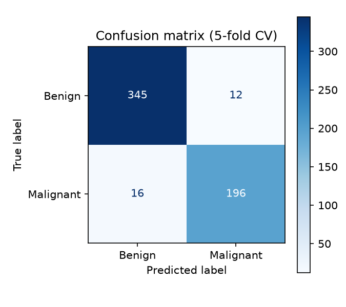
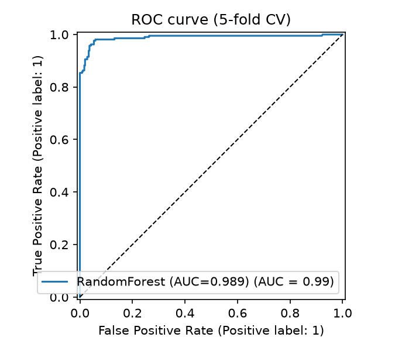

# Breast Cancer Prediction


A machine-learning classifier that predicts whether a breast mass is **malignant or benign** from 30 cell-nucleus measurements, packaged as a **FastAPI** service, a **Gradio** demo, and a **Docker** image with automated tests and CI.

> ⚠️ **Disclaimer:** educational project only. It is not a medical device and must not be used for real diagnosis.

**Live demo:** _coming soon (Hugging Face Spaces)_

## Dataset & model

- **Data:** Wisconsin Diagnostic Breast Cancer (WDBC), 569 samples (357 benign, 212 malignant), 30 numeric features (mean, standard error and worst value of 10 nucleus measurements).
- **Preprocessing:** `StandardScaler` (saved separately as `models/scaler.joblib`).
- **Model:** Random Forest classifier (scikit-learn 1.6.1).

## Results

Estimated with **5-fold stratified cross-validation**, with the scaler fitted inside each fold to avoid data leakage.

<!-- RESULTS:START -->
| Metric | Value |
|---|---|
| Accuracy | 95.1% |
| Recall (malignant) | 92.5% |
| Precision (malignant) | 94.2% |
| F1 (malignant) | 93.3% |
| ROC-AUC | 0.989 |

Lowering the decision threshold trades precision for recall:

| Threshold | Recall (malignant) | Precision (malignant) |
|---|---|---|
| 0.5 | 92.5% | 94.2% |
| 0.4 | 95.8% | 94.0% |
| 0.3 | 97.6% | 90.8% |
<!-- RESULTS:END -->

In a medical screening setting, **recall on the malignant class matters more than accuracy**: a missed malignant case costs more than a false alarm. The decision threshold is configurable (`THRESHOLD` env var) so it can be tuned toward higher recall.

| Confusion matrix | ROC curve |
|---|---|
|  |  |

## Project structure

```
data/           raw dataset (data.csv) and the standardized CSV used for training
notebook/       EDA and model training
models/         final_breast_cancer_model.pkl + scaler.joblib
requirements/   dependency files (api / ui / dev)
src/            inference code and FastAPI app
tests/          API tests (pytest)
docs/           result plots
app.py          Gradio demo
fix_scaler.py   rebuilds models/scaler.joblib from the raw data
evaluate.py     cross-validated metrics and plots
Dockerfile
```

## Run locally

```bash
python -m venv .venv
.venv\Scripts\activate            # Windows  (Linux/macOS: source .venv/bin/activate)
pip install -r requirements/requirements-ui.txt

python app.py                      # Gradio demo -> http://localhost:7860
uvicorn src.main:app --reload      # REST API    -> http://localhost:8000/docs
```

## API

```bash
curl -X POST http://localhost:8000/predict -H "Content-Type: application/json" -d @sample.json
```

| Endpoint | Description |
|---|---|
| `GET /health` | liveness check |
| `GET /model-info` | model type, features, threshold |
| `POST /predict` | 30 features in, label and probabilities out |

Example response:

```json
{"label": "Malignant", "malignant_probability": 0.98, "benign_probability": 0.02, "threshold": 0.5}
```

Inputs are validated: all 30 features are required and must be non-negative numbers.

## Docker

```bash
docker build -t breast-cancer-api .
docker run -p 8000:8000 breast-cancer-api
```

## Configuration

| Env var | Default | Meaning |
|---|---|---|
| `MALIGNANT_CLASS` | `1` | class label that means malignant in the training data |
| `THRESHOLD` | `0.5` | decision threshold on P(malignant) |
| `MODEL_PATH` | auto-detected in `models/` | explicit path to the model file |

## Tests & CI

```bash
pip install -r requirements/requirements-dev.txt
pytest
```

GitHub Actions runs lint, the test suite, and a Docker build with a smoke test on every push.

## Tech stack

Python, scikit-learn, pandas, FastAPI, Pydantic, Gradio, Docker, pytest, GitHub Actions.
